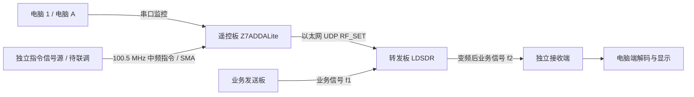

# CCSDS 测控与变频转发实验系统

本项目面向嵌入式芯片与系统设计竞赛，实现遥控指令接收、频率参数解析和业务信号变频转发。当前遥控板采用 **Z7ADDALite（Zynq-7020 + AD9643）**，由 PL 采集 ADC 数据、PS 执行 C 解调与指令处理，再通过以太网控制 **LDSDR 转发板**。

截至 **2026-10-29**，已完成以下实板验证：

- r4c ADC采集通过全通道、四个抽取位置的内部PN9/checker与独立DDR检查；板载ARM解调自测、网口1000 Mbps协商与PC ping 10/10通过。
- 真实100.5 MHz指令经ADC_NORMAL、PS解调、UDP及匹配ACK控制LDSDR，独立SPI读回四组频率；[GUI启停及自动控制](docs/validation/2026-10-28-gui-loop.json)另已通过，GUI nettest按钮未实测。
- 修正LDSDR接收I/Q顺序后，[单音变频转发](docs/rf-forward-bringup.md)与[100 ksym/s文本业务转发](docs/rf-payload-validation.md)通过。两轮文本测试共13个有效信号窗口、19个完整CRC有效帧，三段内容全部一致；静音、关源和坏CRC未误接收。另用遥控板UDP命令触发约1 MHz实际频移，新频点仍恢复正确文本。
- [业务序列与稳定性验证](docs/rf-stability-validation.md)另完成同一TX writer保持输出311.136秒、11次离散快照及8次1000/1001 MHz交替UDP设置。全轮25个窗口中，23个正例恢复29个完整CRC有效帧；7356个条件比较bit无差异，2个负例无有效帧，采样无ADC削顶、转发削顶增量0。
- [独立接收板业务验证](docs/independent-receiver-validation.md)通过8个窗口（5正、3负），恢复8个完整CRC有效帧、1599个条件比较bit无差异；UDP改频后的实测位移999997.235 Hz，全部采样来自新增COM18接收板。
- [真实ADC与业务分时验证](docs/adc-business-staged-validation.md)完成修正版LDSDR的四组真实遥控设置；保留900/1001 MHz设置换线，未再次改频，独立接收端恢复6个完整CRC有效帧、960个条件比较bit无差异，3个负例无有效帧。
- [双端桌面站](sw/ground_station/README.md)提供浅色发送、接收窗口，可现场输入短中文或英文，经外部三板链路恢复文本、消息编号和 CRC。控制器回归完成15个快照、26个有效帧，另完成两个独立桌面进程的实际收发；接收控制器断开重连与发送进程失联保护通过实板检查，见[详细验收](docs/ground-station-validation.md)。
- [演示提速与测控状态回传](docs/station-speed-telemetry-validation.md)：DEBUG临时高速传输将快照周期降至2.87–2.91秒，另完成29快照/26有效帧回归。发送GUI新增带CRC的TM1监控，独立展示UDP/ACK与SPI读回；该管理状态经USB返回。
- [DAC下行数字实现与板端验证](docs/telemetry-downlink-validation.md)：新增90.5MHz有限状态发送链，完整ADC/DAC时序及板端配置读回、单次发送/取消、PN9和网口回归通过。
- [测控下行SMA实收](docs/telemetry-rf-validation.md)：J6/DAC1经新增同轴连接SDR RX1A，三次有限发送恢复12个CRC正确帧、3份不同状态快照；五个停发窗口无有效帧。
- [测控下行GUI采集](docs/telemetry-live-validation.md)：新增会话核验、单次有限发送与真实IQ接收解码，GUI一次约17秒；新增8个CRC正确帧、2份快照，静默对照及采集中关闭清理通过。该阶段返回已有UART网络测试记录。
- [真实遥控与射频回报闭环](docs/telecontrol-roundtrip-validation.md)：两条新ADC_NORMAL指令分别设置900/1001、900/1000MHz，经匹配ACK和独立SPI核对后，DAC下行各恢复4帧对应状态。这是早期由台架工具逐步调度的验证。
- [板端自主测控与第二版GUI](docs/telecontrol-autonomous-validation.md)：一次台架启用后，遥控板自主完成采样、解调、UDP和有限DAC回报；地面改频窗口只连接本地发送板。两笔控制器事务与一笔GUI操作共恢复23个CRC正确帧，独立SPI另行核对一致；单笔约71–73秒。全频率协议扩展及持久化启动尚未完成。
- [第二版业务GUI](docs/business-v2-validation.md)：发送、接收窗口各自只连接本地SDR，经外部发送板→LDSDR→独立接收板传输新文本。两条控制器文本与一条GUI文本通过，接收原始IQ另行重解码；30秒限时停发、停发负例与发送/改频窗口设备互斥通过。台架预先准备转发模式和电平，业务GUI不操作转发板管理口。
- [业务频率计划联动](docs/validation/2026-10-29-frequency-link.json)：发送900.5/901.5 MHz、接收1000.5/1001.5 MHz可静音应用并真实回读；三组业务工作点恢复9个CRC正确帧。补测发现启动阶段转发削顶计数增长，稳定收发时未继续增长，该瞬态尚未消除。
- [新版GUI真实遥控联动](docs/validation/2026-10-29-frequency-tc.json)：GUI设置901.5→1000.5 MHz方案，真实ADC指令和DAC回报恢复7个CRC正确帧，独立SPI一致；发送窗口更新待应用计划，显式交接本地设备后静音配置并读回。修复租约到期后重复选择旧序号的问题，267项主机测试通过。
- [遥控后业务实收](docs/validation/2026-10-29-tc-business.json)：保留上述901/1000 MHz本振接回业务线，新版GUI发送“遥控联动 901.5MHz”，独立接收端恢复相同内容和编号；32份原始IQ盲重解码得到21个CRC正确帧，代表1条消息，停发后8个完整窗口无有效帧。模式和电平仍由台架准备；发送准备阶段削顶计数增加，稳定收发及停止阶段未再增长。

- [远端启停与超时静音](docs/remote-relay-validation.md)：新增开启、停止、查询、ATM2模式和双路电平回报，配套两板RAM固件与三窗口操作。286项主机测试和板间UDP短租期验证后，真实ADC_NORMAL/DAC查询、开启、停止及300秒到期静音也已通过；模式与双路电平经独立SPI核对。发送准备跳过已读回相符的重复配置，当前工作点实测削顶增量0；接回业务线后的两段文本恢复20个CRC正确帧，远端停止负例通过，整轮削顶增量0。改变采样率/带宽仍需先静音，不外推为所有瞬态已消除。

- [反向业务与第二通道](docs/reverse-link-validation.md)：直连端点验证后，原接收板TX1A→LDSDR RX2/TX2→原发送板RX2A实收两条新文本、6个CRC正确帧，输出约1000.5 MHz；源停发与远端停止负例通过，采样无削顶、PL削顶增量0。使用当前固件和UART_NETTEST/UDP启停。随后[三窗口回信GUI](docs/validation/2026-10-29-reverse-gui.json)实收两条新文本、36个CRC正确帧，原始IQ重解码和停发负例通过；双向并发待验。

- [高频有线转发](docs/frequency-range-validation.md)：901.5→2450.5 MHz、1989.5→2179.5 MHz两组各恢复两段文本、6个CRC正确帧，停源与停转对照通过；2900.5 MHz可解码但仍有CRC拒绝，未通过当轮追加质量检查。21份原始IQ独立重解码一致；调谐阶段数字削顶计数累计+5，稳定收发未增。

- [高频预设与三窗口](docs/sband-station-validation.md)：GUI统一1989.5→2179.5、1990.5→2180.5 MHz两组预设，区分计划与回读；反向台架高频文本14帧通过，实际GUI新文本恢复22帧，停发负例及原始IQ重解一致。328项主机测试通过。新增CRC帧头重叠诊断，保留原始候选拒绝计数，不用它直接估算误码率。本轮使用UART_NETTEST/UDP准备转发板；高频真实ADC指令与DAC回报待换线实测。

结论限当前实物、已记录的有线工作点和离散快照。文本使用实验帧，条件比特比较不是整体BER测量；不能据此宣称完整CCSDS协议符合性、24小时稳定性或无跨窗口漏帧。业务与真实遥控同时运行、长期连续运行及持久化启动仍待验收；原接收板TX1A已完成上述业务频点测试，100.5 MHz及其TX2仍未验。

Z7ADDALite 的 FPGA、PS、GUI、可移植测试 runner 和 BSP 重建入口已归档至 [board/z7addalite/](board/z7addalite/README.md)。重建需要外部工具链、2018.3 embeddedsw 源归档及匹配的硬件产物；第三方依赖与命令见板级说明。原有 RTL 环回、PC 演示软件和串口工具继续保留为早期实现。

## 系统组成

| 角色 | 当前硬件或职责 | 说明 |
|---|---|---|
| 电脑 1 / 电脑 A | 操作界面、参数设置、状态与日志 | 串口 GUI 的自检、normal/training 采集、空输入解调及状态显示已实测；[GUI启停及ADC_NORMAL自动控制](docs/validation/2026-10-28-gui-loop.json)已通过；双板UART_NETTEST另经串口命令验证，GUI nettest按钮未实测 |
| 发送端 | 7010_AD9363_SDR，目前分时提供业务信号或遥控指令信号 | DEBUG已识别XC7Z010与Pluto Linux；厂商资料标注AD9363，TX1A/JP1与TX2A/JP3映射已查明；TX1A→ADDA ADC1/J5的100.5 MHz单音与指令实测通过，绝对输出功率未校准 |
| **遥控板** | **Z7ADDALite，XC7Z020-2CLG484-I，AD9643 ADC / AD9122 DAC** | ADC接收指令，PS解调并经网口控制转发板；DAC有限状态发送及SMA实际接收/CRC通过，两条测控链并发待验 |
| **转发板** | **LDSDR（7010_rev3.1）** | 厂商资料标注XC7Z010CLG400-1与AD9363-BBCZ；接收频率设置，执行业务信号变频转发；实际射频频段以实测为准 |
| 独立接收端 | 新增同外观SDR，Pluto Linux，精确芯片型号待核实 | RX1A接收LDSDR业务输出；另已验证TX1A在901.5 MHz附近向网关RX2A发送文本，详见反向端点记录 |
| 模拟板 / 电脑 2 | 终端侧业务接收、显示与反向回信 | 收发程序可独立启动，V2内可切换回发文本；当前单机实板验证通过，第二台电脑现场迁移待完成 |

旧草图下方的名称仍为“遥控板”，现在由 Z7ADDALite 承担。2026-10-28已确认资料对应关系：`LDSDR（7010_rev3.1）`属于转发板，`7010_AD9363_SDR`属于新发送板，是两块独立实物。两套资料均描述通过固件扩展AD9363功能；Linux中的`ad9361-phy`及设备树型号不能作为实物装有AD9361的证据。接口依据和频段限制见[真实输入联调](docs/signal-input-bringup.md)。

COM号仅对应各报告当时的会话。下行联调曾发现COM17/COM19的固件身份与历史角色记录不一致，见[身份与会话说明](docs/telemetry-live-validation.md)。2026-10-29新版业务实测重新核验COM19发送、COM17接收；V2使用当前进程的USB、Linux启动编号和IIO映射绑定，不据此建立永久角色身份。不能直接沿用旧COM号发射；第一版工具的稳定身份限制仍保留。

下面给出目标联动结构中的指令链和一条业务方向，不包含全部双向端口。真实指令设置保留后，换线验证独立接收业务链已通过；当前双端桌面程序仍在电脑1运行。总体目标已按[六线功能计划](docs/six-link-system-plan.md)登记，独立指令源、共用本振资源和测控回传需要单独完成，不能仅凭增加同轴线实现全系统并发。

SMA 接线前需确认实际 TX/RX 端口、输入允许电平和衰减配置。协议中的频率范围与示例值不等于实物全频段可用，短同轴线也不能当作已知衰减器。

## 遥控板接收链

1. AD9643 以名义 **125 MSPS** 采样。双通道 DDR 1:8 解串后，每个 31.25 MHz 向量包含 4 个 A 通道和 4 个 B 通道样点。
2. 固定选择一路的一个样点位置，形成 **31.25 MSPS** 数据流；每次保存 **131072 个 16 位样点，共 256 KiB、4.194304 ms**。
3. PS 裸机 C 程序进行平方律载波恢复、下变频、滤波、符号同步、Viterbi 译码、解随机化和 CRC 校验。
4. 校验通过的 V2 改频指令给出接收频率、转发频率和序号，转换成 **26 字节 UDP RF_SET**；新增启停/查询使用34字节UDP扩展与ATM2回报。只有匹配成功回执才记为已确认生效；新增操作的真实有线射频闭环已验收。

100.5 MHz 在上述采样与抽取路径中最终折叠到 6.75 MHz。当前固定抽取尚无数字抗混叠滤波，真实模拟输入的噪声、干扰和动态范围仍需验证。现阶段按短数据块解调，不宣称连续无间断接收。

详细字段、字节序、金标准向量及 UDP 回执见 [遥控链路 V2 协议](docs/telecontrol-v2.md)。该链路采用自定义短帧，使用 CCSDS 相关同步与编码方法；不据此宣称完整 CCSDS TM/TC 标准符合性。

## 验证进展

| 项目 | 已有结果 | 验证范围 |
|---|---|---|
| M1：ADC 数字接口 | 两次临时 JTAG 加载、六段采集，98,304 个 A 通道样点，PN9 错误 0；B 通道棋盘码及配置读回正确 | 实板内部测试码，不是外部模拟输入 |
| M1：时序 | WNS +0.483 ns，WHS +0.075 ns，TNS/THS = 0 | 已上板 PN9 诊断版本 |
| M2：完整采集工程 | r4c WNS +0.483 ns、WHS +0.022 ns、WPWS +0.264 ns；TNS/THS/TPWS=0，DRC=0；全通道/四个k的真实快照检查通过 | 56条ADC路径与198个动态mailbox端点已复核；早期normal仅格式与切换，本轮另验证真实SMA输入 |
| M3：C 解调 | 三组真实ADC_NORMAL指令由主机及PS正确解码、CRC通过，板端约277 ms；金标准与合成波形测试另已通过 | 本轮先关闭转发验证接收，再完成自动控制；未量化误码率和持续吞吐率 |
| M4：网络控制 | 报文/ACK与网络负例通过；实板PHY识别、1000 Mbps协商及PC→遥控板ping 10/10通过 | UART_NETTEST负例及真实ADC_NORMAL自动控制均通过；LDSDR I/Q修正版另通过三组UART_NETTEST回归 |
| 多板通信 | I/Q修正版LDSDR另通过四组真实ADC_NORMAL→解调→UDP/ACK→SPI读回，applied 30→34 | 当前有线100.5 MHz工作点；每例重复帧观察2秒无新应用，关闭信号2秒无误触发 |
| 真实遥控与业务分时关联 | 保留真实指令产生的900/1001 MHz设置换线，独立接收端在约1001.5 MHz恢复正确业务序列，期间没有再改转发频率 | 6窗口、6个CRC有效帧、960个条件比较bit无差异；收尾才恢复900/1000 MHz；尚未同时运行 |
| 业务RF单音 | RX I/Q修正后，900.5→1000.5 MHz单音转发及1 MHz改频通过；静音/关闭源下降30.43/30.12 dB | 单路有线短快照，无新增削顶 |
| 调制业务与UDP改频 | 三种BPSK文本及负例通过；UART_NETTEST/UDP将实际输出移频约1 MHz后仍正确解码 | 共19个CRC有效帧；实验文本帧，电脑1离线解码；未量化BER、第二路或同时运行 |
| 业务序列与稳定性 | 同一TX writer输出311.136秒、11次离散快照；8次UDP交替改频及软件拒绝/恢复通过 | 全轮25窗口、29个CRC有效帧；7356个条件比较bit无差异，不代表整体BER或连续无漏帧 |
| 独立接收板 | COM18独立采样恢复实验序列，UDP/ACK、SPI与约1 MHz实际RF频移关联通过 | 8窗口、8个完整CRC有效帧；1599个条件比较bit无差异；未验证新板TX或真实遥控同时运行 |

最新证据见 [真实ADC与业务分时摘要](docs/validation/2026-10-28-adc-business-staged.json)，首次输入闭环见 [真实输入闭环摘要](docs/validation/2026-10-28-analog-loop.json)；完整记录、产物摘要和未完成项见 [验证与待办](docs/validation.md)。早期 40 字节 RTL 环回结果见 [历史验证记录](docs/legacy-validation.md)，两者使用不同的板卡与协议路径。

## 仓库内容与使用范围

双端桌面演示：先按[安装和操作说明](sw/ground_station/README.md)安装Python依赖，再分别运行 [start_sender_v2.bat](start_sender_v2.bat) 与 [start_receiver_v2.bat](start_receiver_v2.bat)；本机三窗口用 [start_station_v2.bat](start_station_v2.bat)。接收端迁移到另一台电脑时只启动接收程序。V2本轮快照处理约3.2秒，首条文本提交到首次解码约18.2秒；仍为有空档的分段采样。第一版入口保留作台架工具。

| 路径 | 当前内容 | 适用范围 |
|---|---|---|
| [rtl/](rtl/) | 早期 CCSDS 编解码、滤波与板级适配模块 | 40 字节演示帧的 RTL 路径 |
| [fpga/src/](fpga/src/) | AD936X 板级顶层、接口、约束及工程内 RTL 副本 | 早期射频板工程，不能直接用于 Z7ADDALite |
| [sim/](sim/) | 原 RTL 的测试台和仿真脚本 | 含开发机路径依赖，使用前需调整工具和源码路径 |
| [sw/ccsds/](sw/ccsds/) | 40 字节遥测演示帧编解码与参数表 | 不是 V2 的 8 字节指令实现 |
| [sw/gui/](sw/gui/) | 原遥测参数演示 GUI | 含原开发机的模块搜索路径；不是新遥控板 GUI |
| [sw/ground_station/](sw/ground_station/README.md) | 双端浅色桌面站、实验文本协议、设备控制与测试 | 正向两线业务；接收端只从自己的板卡采样解码 |
| [sw/link/](sw/link/) | 原空间包封装和 LDSDR 串口 CLI 适配 | 保留旧线格式兼容约定，见该目录协议说明 |
| [board/z7addalite/](board/z7addalite/README.md) | r4c PL、PS、GUI源码及重建/测试/快照工具 | 当前Z7ADDALite路线；工具需匹配产物及明确线缆 |
| [board/ldsdr/](board/ldsdr/README.md) | 接收I/Q修正、SPI诊断、安全启动补丁及离线重建/测试 | 第一条有线转发链已实测；依赖已知外部UDP构建缓存，未完成独立BSP重建 |
| [sw/tools/](sw/tools/)、其余 [board/](board/) | 原板卡实验和调试脚本 | 旧工程范围，运行前核对目标板、固件、地址与工具路径 |
| [docs/](docs/) | 当前架构与验收说明、历史图表和报告索引 | 以本 README、V2 协议和最新验证记录为当前描述 |

原 README 中的旧 `fpga/build/build_ccsds_pl_ila.tcl`、`program_and_base.tcl` 未纳入仓库。当前路线使用 [PL冻结构建入口](board/z7addalite/telecontrol_system/README.md)、[PS/BSP重建入口](board/z7addalite/ps_software/README.md) 和 [串口GUI](board/z7addalite/host_software/README.md)。

原脚本中的 U-Boot/Linux 操作针对早期射频板，不能直接用于当前裸机遥控板。Z7ADDALite 的新工程使用 Vivado 2026.1；PS 采用 standalone C + lwIP，已通过现有工具生成 BSP 并运行 ARM 自测，无需为了这条路线安装旧 SDK 2018.3。

## 文档与许可

- [当前遥控链路 V2 协议](docs/telecontrol-v2.md)
- [真实输入联调准备与离线工具](docs/signal-input-bringup.md)
- [业务单音转发与I/Q修正](docs/rf-forward-bringup.md)
- [调制文本与UDP实际改频验证](docs/rf-payload-validation.md)
- [验证结果和后续验收项](docs/validation.md)
- [早期 RTL 与射频实验记录](docs/legacy-validation.md)
- [旧空间包与串口 CLI 协议](sw/link/PROTOCOL.md)
- [文档及历史报告索引](docs/README.md)

本项目及第三方组件的许可与署名见 [LICENSE](LICENSE)。EurySPACE CCSDS RX/TX 来源及原始文件头继续保留；厂商工具、板卡资料和未随仓库分发的驱动不因本次文档更新而改变许可范围。
