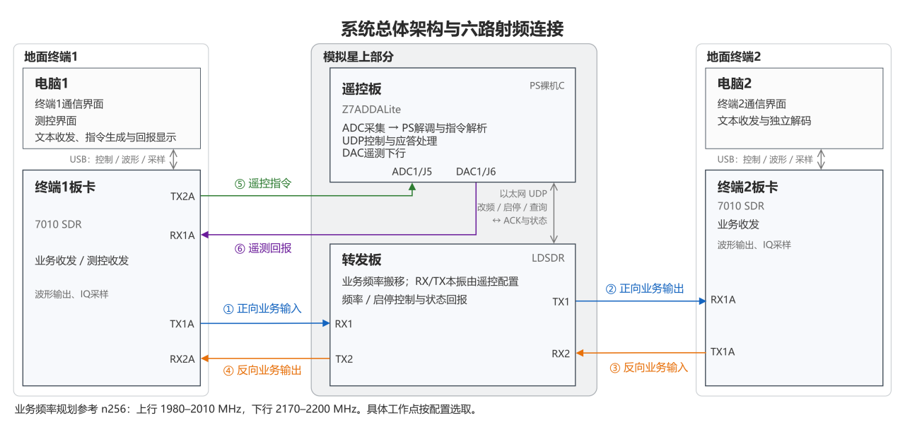

# CCSDS 测控与变频转发实验系统

基于 FPGA 与软件无线电的卫星透明转发载荷地面验证平台。项目面向全国大学生嵌入式芯片与系统设计竞赛 FPGA 自主选题赛道，使用两块 7010 SDR、Z7ADDALite 遥控板和 LDSDR 转发板，在固定六线有线台架上验证双向业务转发、射频遥控和执行状态回报。

[双电脑操作说明](docs/two-computer-guide.md) · [验证记录](docs/validation.md) · [更新日志](CHANGELOG.md) · [文档索引](docs/README.md)

## 系统怎样工作

| 路径 | 信号流程 |
| --- | --- |
| 双向业务 | 两个终端经 LDSDR 双路透明变频转发，各自在板端 ARM 解码并由电脑显示正文 |
| 测控上行 | 终端1 TX2A 发出 100.5 MHz 指令 → Z7ADDALite 采集、解码 → 通过以太网向 LDSDR 提交控制事务 |
| 状态回报 | LDSDR 返回执行状态 → Z7ADDALite 通过 DAC 生成 90.5 MHz 射频回报 → 终端1接收，电脑解析并显示 |

双向业务可在已验工作点并行收发。测控与终端1业务共用本振，按时段切换。完整端口、接线和工况见 [六线台架验证](docs/six-line-validation.md)。

## 技术特点

- **遥控板自研 FPGA 逻辑**负责高速 ADC 接口、跨时钟域缓存、采集完整性检查和 DAC 调制发送。ARM 完成指令解调、协议处理和网络事务。
- **可核验的远程测控**支持改频、启停和查询。终端核对匹配的射频回报，验收记录另用 SPI 回读核对转发板配置。
- **范围内独立改频**支持 1 kHz 设置步进。业务输入中心为 1980.100–2009.900 MHz，输出中心为 2170.100–2199.900 MHz。[频率计划与验证](docs/free-frequency-validation.md)
- **频偏补偿实验**包含 LDSDR 双路业务补偿及 ADDA 测控上行原型。两个扩展默认关闭，仓库记录的验证范围为离线测试和构建。[业务补偿](docs/doppler-compensation.md) · [测控原型](docs/doppler-telecontrol-prototype.md)

## 代表性结果

| 指标 | 验证结果 | 记录 |
| --- | --- | --- |
| 持续接收与文本实收 | 1989.5 → 2179.5 MHz 台架持续接收约 30 分钟，周期性发射的 60 条独立中文消息全部在对端通过内容、编号和 CRC 核验 | [接收性能与恢复](docs/validation/20261101_receive_pipeline.md) |
| 板端接收处理速率 | 上述工况两端稳态均约 2.500 MSPS | [接收性能与恢复](docs/validation/20261101_receive_pipeline.md) |
| 常规测控至业务恢复 | 22.70–29.48 秒，包含业务暂停、射频回报核验和接收恢复 | [耗时优化验收](docs/validation/20261101_control_latency.md) |
| 遥控板 ADC/DAC 逻辑 | candidate04 布局布线后 WNS +0.066 ns，WHS +0.048 ns | [DAC 实现记录](docs/telemetry-downlink-validation.md) |

## 启动演示

1. 按 [双电脑操作说明](docs/two-computer-guide.md) 核对接线、板卡与环境。Windows 首次使用运行 [setup_station.bat](setup_station.bat)。
2. 电脑1运行 [start_terminal1.bat](start_terminal1.bat)，电脑2运行 [start_terminal2.bat](start_terminal2.bat)。单电脑台架可在 [start_station_v2.bat](start_station_v2.bat) 中选择菜单项 3。
3. 两端分别连接本地 SDR 并应用匹配的收发频率。从终端1窗口进入测控，设置远端频率并收到成功回报后开启转发，再互发新文本核对实收。

## 仓库入口

| 路径 | 内容 |
| --- | --- |
| [board/z7addalite/](board/z7addalite/README.md) | 遥控板 FPGA、PS、采集与重建说明 |
| [board/ldsdr/](board/ldsdr/README.md) | 转发板数字通路、裸机控制与重建 |
| [board/terminal/stream_rx/](board/terminal/stream_rx/) | 终端 ARM 流式接收程序与构建记录 |
| [sw/ground_station/](sw/ground_station/README.md) | 桌面站、业务协议和设备控制 |
| [docs/](docs/README.md) | 接线、协议、实板验收及报告索引 |
| [rtl/](rtl/)、[fpga/src/](fpga/src/)、[sim/](sim/) | 早期 RTL、板级工程与仿真 |
| [archive/local_sources/](archive/local_sources/README.md) | 历史源码归档 |

项目及第三方组件的许可与署名见 [LICENSE](LICENSE)。
