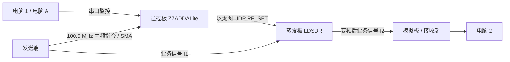

# CCSDS 测控与变频转发实验系统

本项目面向嵌入式芯片与系统设计竞赛，实现遥控指令接收、频率参数解析和业务信号变频转发。当前遥控板采用 **Z7ADDALite（Zynq-7020 + AD9643）**，由 PL 采集 ADC 数据、PS 执行 C 解调与指令处理，再通过以太网控制 **LDSDR 转发板**。

截至 **2026-10-27**，已完成遥控板 125 MSPS ADC 数字接口验证和板载 ARM 合成波形解调自测；真实中频指令接收、遥控板到转发板的 UDP 联调及多板业务通信仍待验收。仓库中原有的 RTL 环回、PC 演示软件和串口控制工具继续作为早期实现保留。

**本次更新发布架构、协议约定和验证记录。Z7ADDALite 的新 FPGA、PS、GUI 源码尚未纳入仓库，不能仅凭当前仓库重建新遥控板固件。**

## 系统组成

| 角色 | 当前硬件或职责 | 说明 |
|---|---|---|
| 电脑 1 / 电脑 A | 操作界面、参数设置、状态与日志 | 新遥控板串口 GUI 已有原型，完整联机验收待完成 |
| 发送端 | 提供业务信号和遥控指令信号 | 对应旧草图左上角“ADDA”的替换板；具体型号、端口和固件需在联调前逐板登记 |
| **遥控板** | **Z7ADDALite，XC7Z020-2CLG484-I，AD9643 ADC** | 接收 100.5 MHz 中频指令，PS 解调后通过网口控制转发板；DAC 不参与当前接收链 |
| **转发板** | **LDSDR** | 接收频率设置，执行业务信号变频转发；实际射频频段以该实物及固件验证结果为准 |
| 模拟板 / 电脑 2 | 业务端发送、接收与验证 | 保留原系统角色，板卡身份、信号方向及端口在多板联调时确认 |

旧草图下方的名称仍为“遥控板”，现在由 Z7ADDALite 承担。资料目录名 `7010_AD9363_SDR` 不代表另有一块转发板，也不能用来推断 Z7ADDALite 的器件型号。

下面给出当前优先验收的指令链和一条业务转发方向；它不是全部双向端口的接线图。

SMA 接线前需确认实际 TX/RX 端口、输入允许电平和衰减配置。协议中的频率范围与示例值不等于实物全频段可用，短同轴线也不能当作已知衰减器。

## 遥控板接收链

1. AD9643 以名义 **125 MSPS** 采样。双通道 DDR 1:8 解串后，每个 31.25 MHz 向量包含 4 个 A 通道和 4 个 B 通道样点。
2. 固定选择一路的一个样点位置，形成 **31.25 MSPS** 数据流；每次保存 **131072 个 16 位样点，共 256 KiB、4.194304 ms**。
3. PS 裸机 C 程序进行平方律载波恢复、下变频、滤波、符号同步、Viterbi 译码、解随机化和 CRC 校验。
4. 校验通过的 V2 指令给出接收频率、转发频率和序号。控制层将其转换成原 LDSDR 接口的 **26 字节 UDP RF_SET**，匹配成功回执后才记录为已确认生效。

100.5 MHz 在上述采样与抽取路径中最终折叠到 6.75 MHz。当前固定抽取尚无数字抗混叠滤波，真实模拟输入的噪声、干扰和动态范围仍需验证。现阶段按短数据块解调，不宣称连续无间断接收。

详细字段、字节序、金标准向量及 UDP 回执见 [遥控链路 V2 协议](docs/telecontrol-v2.md)。该链路采用自定义短帧，使用 CCSDS 相关同步与编码方法；不据此宣称完整 CCSDS TM/TC 标准符合性。

## 验证进展

| 项目 | 已有结果 | 验证范围 |
|---|---|---|
| M1：ADC 数字接口 | 两次临时 JTAG 加载、六段采集，98,304 个 A 通道样点，PN9 错误 0；B 通道棋盘码及配置读回正确 | 实板内部测试码，不是外部模拟输入 |
| M1：时序 | WNS +0.483 ns，WHS +0.075 ns，TNS/THS = 0 | 已上板 PN9 诊断版本 |
| M2：完整采集工程 | 仿真通过；候选工程 WNS +0.483 ns、WHS +0.014 ns，TNS/THS = 0 | 跨时钟总线物理延迟约束仍待补齐复核；尚未从 PS 验收真实 ADC 快照 |
| M3：C 解调 | 三组帧金标准、45 组合成波形测试通过；真实 Cortex-A9 解调 131072 点合成波形耗时 279 ms | 板载运算自测，不是实际信号接收，也不是持续吞吐率 |
| M4：网络控制 | 报文与 ACK 状态逻辑测试通过 | 无网线链路时发现 lwIP 断言卡死；修复及双板联调待验收 |
| 多板通信 | 板卡已具备，可安排联调 | 尚未验收完整遥控闭环和业务信号转发 |

完整记录、产物摘要和未完成项见 [验证与待办](docs/validation.md)。早期 40 字节 RTL 环回结果见 [历史验证记录](docs/legacy-validation.md)，两者使用不同的板卡与协议路径。

## 仓库内容与使用范围

| 路径 | 当前内容 | 适用范围 |
|---|---|---|
| [rtl/](rtl/) | 早期 CCSDS 编解码、滤波与板级适配模块 | 40 字节演示帧的 RTL 路径 |
| [fpga/src/](fpga/src/) | AD936X 板级顶层、接口、约束及工程内 RTL 副本 | 早期射频板工程，不能直接用于 Z7ADDALite |
| [sim/](sim/) | 原 RTL 的测试台和仿真脚本 | 含开发机路径依赖，使用前需调整工具和源码路径 |
| [sw/ccsds/](sw/ccsds/) | 40 字节遥测演示帧编解码与参数表 | 不是 V2 的 8 字节指令实现 |
| [sw/gui/](sw/gui/) | 原遥测参数演示 GUI | 含原开发机的模块搜索路径；不是新遥控板 GUI |
| [sw/link/](sw/link/) | 原空间包封装和 LDSDR 串口 CLI 适配 | 保留旧线格式兼容约定，见该目录协议说明 |
| [sw/tools/](sw/tools/)、[board/](board/) | 原板卡实验和调试脚本 | 运行前核对目标板、固件、地址与工具路径 |
| [docs/](docs/) | 当前架构与验收说明、历史图表和报告索引 | 以本 README、V2 协议和最新验证记录为当前描述 |

当前仓库没有原 README 所列的 `fpga/build/build_ccsds_pl_ila.tcl`、`program_and_base.tcl`，因此不再提供调用这些缺失文件的构建/下载命令。新工程的可重建入口将在源码整合时一并发布。

原脚本中的 U-Boot/Linux 操作针对早期射频板，不能直接用于当前裸机遥控板。Z7ADDALite 的新工程使用 Vivado 2026.1；PS 采用 standalone C + lwIP，已通过现有工具生成 BSP 并运行 ARM 自测，无需为了这条路线安装旧 SDK 2018.3。

## 文档与许可

- [当前遥控链路 V2 协议](docs/telecontrol-v2.md)
- [验证结果和后续验收项](docs/validation.md)
- [早期 RTL 与射频实验记录](docs/legacy-validation.md)
- [旧空间包与串口 CLI 协议](sw/link/PROTOCOL.md)
- [文档及历史报告索引](docs/README.md)

本项目及第三方组件的许可与署名见 [LICENSE](LICENSE)。EurySPACE CCSDS RX/TX 来源及原始文件头继续保留；厂商工具、板卡资料和未随仓库分发的驱动不因本次文档更新而改变许可范围。
