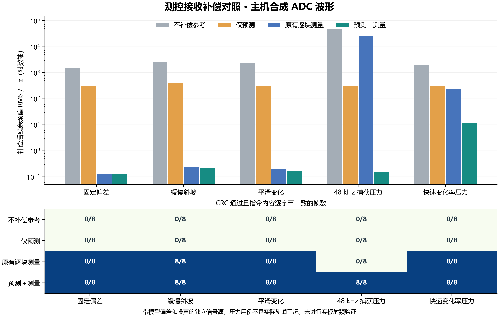
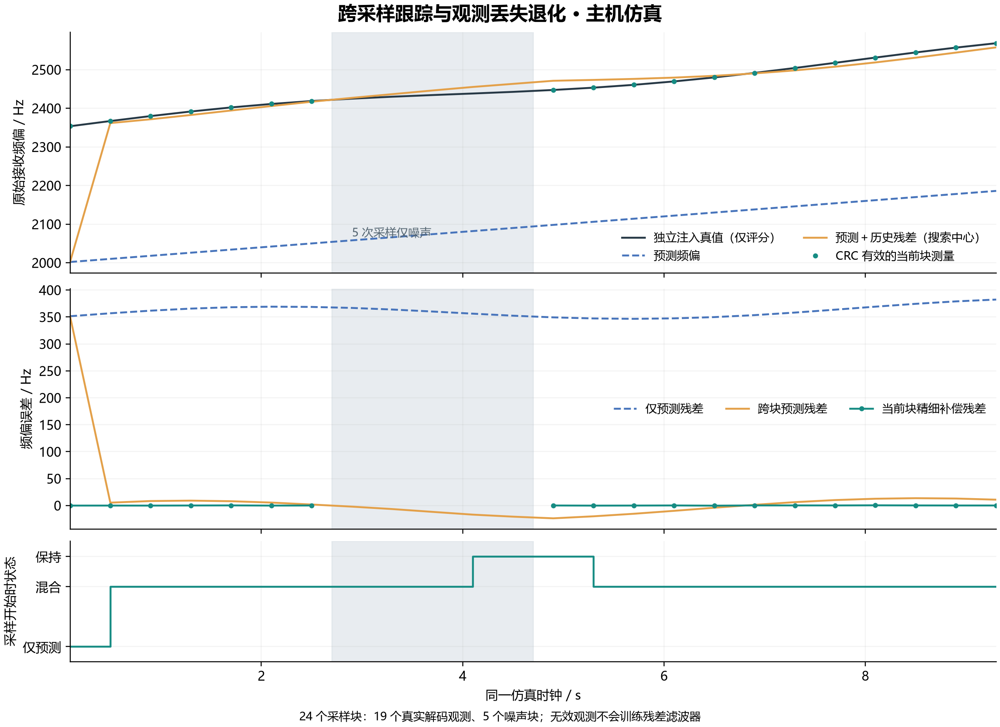

# 遥控上行的预测与测量多普勒补偿

2026-11-01。早期测控原型实现一个默认关闭的板端 C 扩展：预测负责搜索中心及频偏变化率，平方律测量负责当前块精细校正，可信观测再修正后续采样的预测。现有三个 UI、终端收发参数、六根 SMA 接线、遥控协议、转发板配置和五分钟租期均未修改。

**本文记录的是2026-11-01早期主机合成波形验证和 Cortex-A9 编译/链接，不是该轮实板动态射频验证。** 该轮实验 ELF 没有下载，演示中的板卡和串口没有被接管。后续团队确认测控上行补偿测试通过，见[2026-11-03验收结论](validation/20261103_acceptance.md)；下文数值仍对应早期离线实验，不改写成后续实测数据。

业务转发补偿的现行实现见[主文档](doppler-compensation.md)。本文保留测控接收原型的范围和离线记录。

## 1. 接入位置与范围

```text
已有路径：终端1 TX2A → 100.5 MHz → 遥控板 ADC1/J5
       → PL 125 MSPS、每4点取1点 → 31.25 MSPS 实数样本
       → 可选预测/变化率补偿＋平方律精细载波恢复
       → 原有 CCSDS 相关解码、CRC和命令检查 → 原 UDP/ACK → LDSDR
```

100.5 MHz 在当前采样合同下映射为正的 6.75 MHz 别名频率，附近频移的符号不反转。几何计算使用实际 RF 载频 100.5 MHz；6.75 MHz 只用于数字混频，不能拿来计算卫星相对速度造成的物理多普勒。

ADDA 采不到两路 GHz 业务的 IQ，所以这个早期接收原型只对测控上行接收做补偿。没有修改 LDSDR 的 DDC/DUC，也没有给业务链增加频偏估计点。不能把本结果表述为“星上双向业务链路已完成多普勒闭环补偿”。测控上、下行及业务两方向的传播/本振误差也不能无条件共用一个估计。

本项目仍为原理验证系统。3GPP TS 38.300 V18.4.0 §16.14.2.2 规定 NTN UE 利用位置与星历进行业务链上行频率预补偿，馈电链多普勒及转发器频率误差的处理留给网络实现。这里的遥控接收算法不构成完整 NR/6G NTN 协议栈，也不以“业界没有星上补偿”为创新性前提。[ETSI 原规范](https://www.etsi.org/deliver/etsi_ts/138300_138399/138300/18.04.00_60/ts_138300v180400p.pdf)

## 2. 算法与单位

设相对位置、速度、加速度为同一惯性坐标系、同一时刻下的卫星减地面量：

\[
\rho=\|\mathbf r\|,\quad
\dot\rho=\mathbf r\cdot\mathbf v/\rho,\quad
\ddot\rho=(\mathbf v\cdot\mathbf v+\mathbf r\cdot\mathbf a-\dot\rho^2)/\rho
\]

\[
f_D=-\frac{f_c}{c}\dot\rho,\qquad
\dot f_D=-\frac{f_c}{c}\ddot\rho,\quad c=299792458\ \mathrm{m/s}
\]

这是单向、非相对论近似；远离产生负频移，靠近产生正频移。`dp_geometry()` 实现这些计算。也可输入带本地时间戳的线性预测段 `f0 + rate × Δt`。本阶段没有 TLE 解析、GNSS 接收或轨道传播；轨道来源及时间映射需要后续显式提供。载频、时间及相对运动信息是预测所需的独立输入，而非从接收真值反推模型。[MathWorks 卫星多普勒计算接口说明](https://www.mathworks.com/help/satcom/ref/matlabshared.satellitescenario.satellite.dopplershift.html)

测得的 CFO 还含发射机/接收机本振误差，不能全解释为轨道多普勒。模型与测量在采样时刻对齐：

\[
b_{obs}=f_{measured}(t_{capture})-f_{pred}(t_{capture})
\]

残差以 alpha-beta 形式更新（默认 α=0.3、β=0.04），有幅度、变化率、创新量和时间门限。若输入观测来自已经施加加性校正 `c_applied` 的信号，则先还原 `f_measured = f_residual − c_applied`。本适配器的平方谱估计来自原始 ADC，故该字段为 0，避免重复减去补偿或跟踪自身 NCO。

跨块计划为 `f_pred + b_filtered`。对一个采样块，先在平方信号中移除预测的二次相位，再搜索二倍载波谱线并细化；最终混频器使用当前块精细估计的起始频率及预测变化率。即“预测作粗补偿与动态引导，测量作精细修正”。历史残差是下一块的搜索先验，不把它在本块精细估计后再加一遍。

131072 点捕获覆盖约 4.194304 ms。本轮支持块内线性变化率，跨块保留残差状态；没有证明无间断实时处理，也没有改变原有符号定时恢复方式。现有 1 kHz 遥控设置步进是本振配置合同，软件混频的浮点频偏修正不改变该合同。

## 3. 默认行为与异常退化

- 编译宏 `ADDA_DOPPLER_ENABLED` 默认 0；只有 `--doppler-enabled` 构建接入控制器，且运行时仍为 OFF。
- OFF 保留原有逐块平方律载波恢复，**不是关闭全部载波补偿**。测试中的“不补偿参考”是独立对照模式。
- 采集时间来自 ARM 命令而非解码结束。现有 PL 没有首样点硬件时间戳，用 ARM 至 DONE 首次观测的区间保守界定时间误差。
- 时间不确定度超过 20 ms，或该不确定度乘计划变化率超过 50 Hz，回退原解调；没有偷偷使用解码完成时刻替代采样时刻。
- 只用 CRC 正确、RMS/削顶检查通过的观测更新状态。噪声候选、错误链路/通道、重复/乱序、过期测量不能刷新有效性。
- 新鲜测量 1500 ms，保持最长 5000 ms；保持期间不无限外推残差斜率。模型过期或计划超界则回退原解调，日志明确显示计划无效。
- 模型最长 600 s，接收偏移上限 ±60 kHz、变化率上限 ±250 kHz/s；这些是实验软件门限，**不是轨道指标或新增射频工作范围**。
- 新模块不调用 RF_SET/ENABLE，不续租、不解除静音、不修改已有成功/拒绝回报。`doppler off` 只关闭新接收算法。

## 4. 验证方法与结果

波形源使用已有 SRRC 参考与固定金标准 CADU，独立注入真实频偏、变化率、模型偏差、噪声及本振偏差。C 解调器只获得 ADC 样本和预测模型；真值只用于波形生成和评分，未作为测量输入滤波器。三组旧金标准、反极性及坏 CRC 等原有 45 个用例全部通过。

七类场景，每类每算法 8 次，共 **224 个对照采样块**。每个成功判定都要求 CRC 通过且 8 字节指令内容与源逐字节一致。新混合路径 56/56 帧通过；不是“实测误码率为零”，没有报告未统计的 BER。

| 场景 | 原有逐块测量 CRC | 混合补偿 CRC | 原有残余 RMS / Hz | 混合残余 RMS / Hz |
|---|---:|---:|---:|---:|
| 预测与信号匹配 | 8/8 | 8/8 | 0.139 | 0.134 |
| 固定频偏＋模型误差 | 8/8 | 8/8 | 0.134 | 0.134 |
| 缓慢斜坡＋偏差 | 8/8 | 8/8 | 0.236 | 0.222 |
| 平滑变化＋偏差 | 8/8 | 8/8 | 0.198 | 0.168 |
| +48 kHz 捕获压力 | 0/8 | 8/8 | 25000.881 | 0.155 |
| +200 kHz/s 变化率压力 | 8/8 | 8/8 | 242.159 | 12.109 |
| −200 kHz/s 变化率压力 | 8/8 | 8/8 | 242.159 | 12.109 |

RMS 是已知注入瞬时频率减去软件实际混频频率，在整个捕获窗口上的误差；不是信号幅值 RMS。汇总 JSON 还保留逐帧 P95、最大误差和主机耗时。误差数值不代表实物晶振/ADC 时钟校准精度。

仅预测在预测准确场景中为 8/8；在故意加入 300～400 Hz 模型/本振偏差的场景中为 0/8，说明预测不能代替残差测量。普通缓慢频移下，原算法已经足够，不能把本轮改进宣传成所有场景都有明显收益。快速变化率场景中两种接收器 CRC 都通过，改善体现在残余频偏，不能写成原算法无法通信。

+48 kHz 与 ±200 kHz/s 是算法压力输入，不是 100.5 MHz LEO 实际轨道工况。高变化率仿真使用精确采样时刻；当前板端时间戳保护会拒绝时间不确定度过大的此类计划，因此不能由该仿真直接推出实板可补偿同样的变化率。



另做 24 个连续时间采样块，5 个只含噪声，19 个有效观测全部来自实际 C 解调结果。无效块不更新滤波器，出现 HOLD，恢复有信号后重新接受测量。时间回绕、模型过期、错误链路、削顶、坏质量、重复/乱序和校正只计一次也进行了定向验证。



## 5. 回归与构建证据

| 验证层级 | 结果 | 不能替代的验证 |
|---|---|---|
| C 核心 | 80 项状态/几何断言通过；单 tracker 主机 ABI 168 字节 | 板端 CPU 用量、实际 RAM 高水位 |
| 默认采集控制器 | 原 11216 项断言通过 | ADC 真实时序/采样质量 |
| 可选控制器 | 同一套回归及真实解调接入测试通过 | 实板输入动态波形 |
| PS/协议/服务 | 281 项 PS 断言、kHz/启停协议、服务和两种遥测开关回归通过 | 新补偿固件的板间真实闭环 |
| 旧解调波形 | 45/45 通过 | 宽频动态射频覆盖 |
| 默认路径差分 | 与提交 `7600e45` 对照 16 组输入，返回值、解码帧及全部解调统计一致 | 所有可能输入的形式等价证明 |
| A9 构建 | 默认与 Doppler 两套自检/采集 ELF 均链接通过 | CPU 上执行、JTAG 下载、ADC/RF 实测 |

实验采集 ELF 的 text 为 435236 字节，对照默认构建为 429836 字节，增加约 5.3 KiB。两者使用相同 BSP/XSA/PS 初始化。仅有既有链接脚本的 RWX LOAD segment 警告，没有新 C 编译警告。没有重综合 PL，没有烧录启动介质。

测试结果：[汇总及原始逐帧数据](validation/20261101_doppler.json)、[逐帧 CSV](validation/20261101_doppler_frames.csv)、[跨块 CSV](validation/20261101_doppler_tracking.csv)。复现命令、运行时接口和文件分工见 [源码说明](../board/z7addalite/software/doppler/README.md)。PNG 可放报告，旁边同名 SVG 用于矢量排版。

## 6. 报告可采用的表述

> 在现有测控接收链上增加了可选的预测与测量联合频偏补偿模块。该模块由径向运动模型或带时间戳的预测段给出粗频移及变化率，通过平方律载波估计得到精细修正，并以 CRC 有效观测更新跨块残差。合成 ADC 波形验证覆盖模型偏差、动态频偏、噪声、观测丢失和过期处理；在本轮指定的 56 个混合补偿采样块中均恢复出正确指令。模块已完成 Cortex-A9 编译链接，默认关闭，不改变已有桌面演示路径。当前证据限于主机波形与控制器模型测试，动态射频和板端运行性能尚待实测。

下一次可独立安排实验固件 RAM 加载、板端零频移回归、受控动态波形输入和接收耗时测量。验证后恢复原演示固件。若继续扩展到 GHz 双向业务补偿，需另加各业务方向的观测与执行接口、核对 NCO 动态更新及跨板时钟；这不属于本轮已完成结果。
