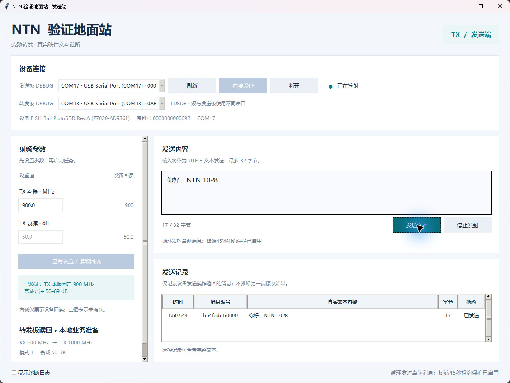
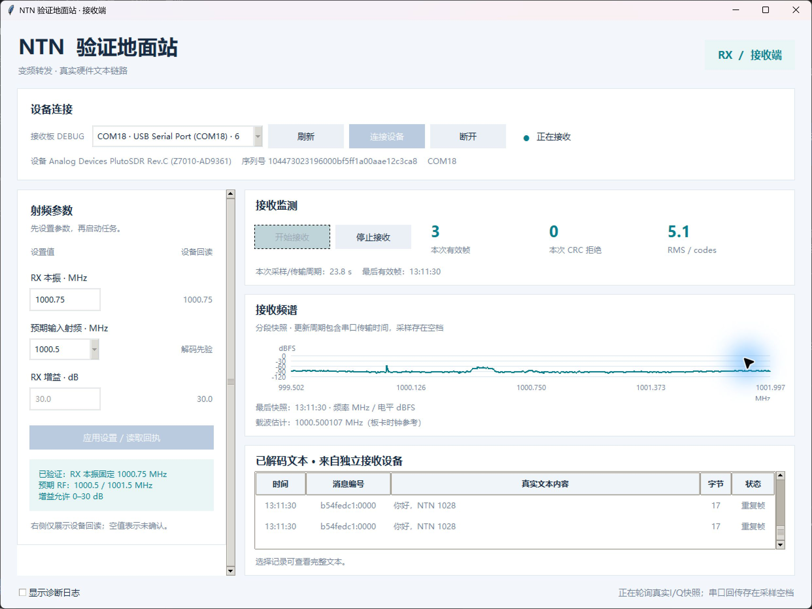

# 双端桌面站验证

日期：2026-10-28。新增桌面程序位于 [sw/ground_station](../sw/ground_station/README.md)，发送、接收以独立进程运行。两端均采用浅色界面，分别控制自己的设备。本轮在电脑1上连接全部板卡，接收内容来自独立接收板的原始 I/Q；两个程序没有交换正文的本机或网络通道。

## 接线与参数

```text
发送 GUI → 发送板 TX1A ──SMA──→ LDSDR RX1
                              LDSDR TX1 ──SMA──→ 接收板 RX1A → 接收 GUI
             COM17                 COM13                COM18
```

本轮使用现有两根业务同轴。Z7ADDALite 与 LDSDR 的网线及各板 DEBUG 保持连接，遥控板没有接入模拟信号。本阶段通过 LDSDR DEBUG 本地准备业务转发，不把这一操作记作真实 ADC 遥控。

| 项目 | 本轮配置与回读 |
| --- | --- |
| 发送板 | USB 序列号 `000000000069B`；TX LO 900000000 Hz，发送时衰减50 dB，静音时89 dB |
| LDSDR | USB 调试序列号 `0ABC01B`；RX LO 900000000 Hz、TX LO 1000000000 Hz；运行时 gain30、txatt50、mode1 |
| 独立接收板 | IIO 序列号 `104473023196000bf5ff1a00aae12c3ca8`；RX LO申请1000750000 Hz，回读1000749998 Hz，增益30 dB |
| 波形 | BPSK，100 ksym/s，2.5 MSPS，SRRC roll-off 0.35，+500 kHz调制偏移 |
| 业务频率 | 输入名义900.5 MHz，输出名义1000.5 MHz；接收解码先验为−249998 Hz |
| 应用正文 | 1–32 UTF-8字节，G1会话号与序号，外层CRC16 |

发送板的 IIO `hw_serial` 为空，程序明确采用 USB 序列号作为身份回退；接收板 USB 序列号仅为 `6`，使用其 IIO 序列号核对。COM编号只代表本次电脑枚举。Linux设备树中的AD9361型号文字不是对实际芯片型号的独立鉴定。

LDSDR沿用已验证的I/Q修正版：RXswap0、TXswap1、RF寄存器0x010=0x88，采样率30.72 MSPS。本轮没有重新下载位流、刷写SD或Flash；桌面程序只创建板端RAM临时文件并配置运行状态。

## 软件与实板结果

50项软件测试通过，覆盖帧解析、CRC错误拒绝、UTF-8长度、重复/冲突判定、串口分段响应、文件长度及SHA256、失败清理、保护进程、设备重连和UI线程队列。最小1000×840窗口另检查接收文本行可见及频谱刻度不重叠，修正高缩放下频谱挤占文本区域的问题。

实板控制器回归记录于 `acceptance3/`，共完成15个采样窗口，恢复26个CRC有效应用帧：

| 用例 | 结果 |
| --- | --- |
| 无发送基线 | 无有效应用帧 |
| `hello world` | 正确恢复新消息及重复帧 |
| `你好，NTN！` | UTF-8正文、消息编号与CRC一致 |
| `12345678901234567890123456789012` | 32字节上限正文正确恢复 |
| 停止发射 | 两个后续静音窗口无有效应用帧 |
| 接收端断开、重连、重新配置 | 正确恢复新消息 `reconnect OK` |
| 正常停止与关闭 | 控制器清理完成，没有清理错误 |

实际桌面交互另以两个独立 Python 进程运行，选择发送板、转发板和接收板，应用设置、开始接收，再现场输入 `你好，NTN 1028`。解码结果由接收进程自己的I/Q产生，发送、接收消息编号一致；界面展示正文、重复帧、频谱、载波估计、采样耗时及参数回读。原始快照脱离GUI再次解码，结果与保存的分析文件逐项比较。最终窗口数、摘要与文件SHA256见[结构化验收记录](validation/2026-10-28-ground-station.json)。





截图记录测试时刻，不能作为当前仍在发射的证明；收尾状态以独立回读为准。截图后另将紧凑窗口的纵轴刻度改为按高度自动疏排，采样与解码代码未变。

最终桌面交互会话 `gui_receiver3/` 完成23个窗口，恢复28个CRC有效应用帧，消息编号为 `b54fedc1:0000`，正文为 `你好，NTN 1028`；包含启动前及停止后的无帧窗口。控制器回归、先前桌面布局检查和最终桌面交互合计55个保存窗口重新解码均与原报告一致。控制器回归有2个CRC拒绝候选，最终桌面会话亦有2个；未作为正确内容展示，也不据此推算BER。全部55个窗口没有采样分量削顶。

## 失联保护与停止

发送板在开始发射前启动板端保护进程，租约45秒、检查间隔2秒，控制器正常运行时约每10秒续租。实板测试强制结束本次拥有的发送主机进程，之后在约53.06秒时观察到 `guard_state=expired`、TX LO关闭、两路TX衰减89 dB、发送buffer为0。这是观察时刻，不宣称测得精确45秒关断延迟；本轮没有物理拔USB。

该租约保护只驻留发送板，不能保证主机崩溃时LDSDR同步静音。异常退出测试之后，LDSDR通过独立控制清理至mode2、txatt89、rxgain0。正常UI“停止发射”与关闭会同时请求发送板和LDSDR静音并核对回读；未确认完成时报告错误。

最终独立回读检查发送板和接收板：TX LO关闭、两路衰减89 dB、DDS比例全零、TX/RX buffer均为0；LDSDR为mode2、txatt89、rxgain0，LO恢复900/1000 MHz；遥控板auto/network/armed/pending均为0，decoded244、applied34与本轮开始前一致。

## 演示限制与后续范围

单次32768个复数样本覆盖13.1072 ms RF时间，131072字节I/Q经115200波特DEBUG以十六进制传输，完整采样/传输实测约23.8秒。两次快照之间有空档；发送端循环输出当前消息供离散快照捕获。频谱和帧统计只对应返回窗口，CRC拒绝数也不是BER分母。

当前正文协议是实验文本帧，使用已有BPSK物理层；与遥控板V2指令帧分开，不宣称完整CCSDS或3GPP NTN空口符合性。第二台电脑的实际迁移、连续高速数据回传、反向业务、DAC测控回传和六线并发尚未验收。后续按[六线计划](six-link-system-plan.md)核对共用本振和通道资源。

初次实板接入发现接收固件没有base64工具，传输改用已确认存在的xxd，并保留长度及SHA256验证；另一轮发现重连时私有临时目录已存在，改为允许重用本实例目录。最终回归在修正后执行。早期失败日志与完整成功日志均保存在电脑1的 `D:/RelayTools/work/ground_station_20261028/`；发布归档路径、大小和SHA256见结构化验收记录。Git仓库保留源码、测试、说明、截图及精简证据索引，不包含虚拟环境或厂商构建缓存。
